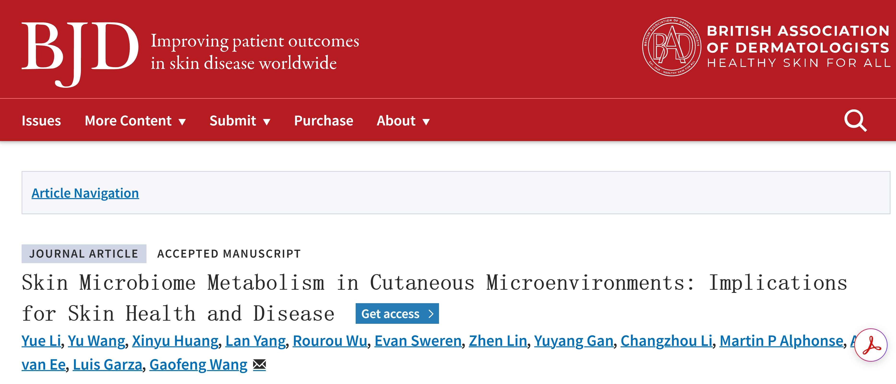

# cxj-smoothwrite

**smoothwrite v2.0.1**：将用户提供的论文 PDF 和期刊截图，按已确认的皮肤微生态 SMOOTH 模板、写法和文风，制作成可编辑、可离线分享的微信公众号 HTML。

## 使用流程

提供两份资料：

1. 一篇论文的 PDF。
2. 一张包含期刊标识、论文标题等信息的期刊页面截图。

在 Codex 中调用：

> 使用 $smoothwrite，把这份 PDF 和期刊截图按 SMOOTH 模板生成对应的 HTML。

Codex 阅读原文，撰写标题、团队导语和高信息密度的论文概述，再将本篇资料放入现有模板。用户无需另写正文、填写 JSON 或重新提供内置团队资料。

主要交付物是 `preview.html`：图片、二维码、完整论文页图及原始 PDF 均内嵌，可单文件发给教授，下载后用电脑浏览器打开，支持文字编辑、原文翻页、放大和保存草稿。

## 模板与文风

### 已确认的完整范文

仓库内保留了实际测试并确认的 BJD 推文，供查看排版和学习文风：

- **[下载可编辑 HTML 成品](https://github.com/SkinMicrobe/cxj-smoothwrite/raw/refs/heads/main/examples/bjd-ljag463/preview.html)**：下载后用电脑浏览器打开。正文、期刊截图、头像、二维码、49页原文图片和原始 PDF 均内嵌，可单文件离线使用。GitHub 文件页本身不渲染 HTML。
- [阅读文字范文](examples/bjd-ljag463/article.md)：已确认的标题、团队导语和概述。
- [查看配套图片](examples/bjd-ljag463/assets)：真实期刊头图、团队 logo、作者照片、二维码及全部原文页图。
- [查看模板源文件](assets/preview-template.html)与[范文内容 JSON](examples/bjd-content.json)：用于理解模板和制作新稿。

完整范文沿用已确认页面；仅将原来的相对 PDF 下载链接改为内嵌数据，便于单文件分享。`examples/bjd-content.json` 是生成脚本的字段和写法示例，完整成品以本节 HTML 为准。新论文沿用版式及文风，不能照抄该文的研究结论或作者身份。



默认顺序：期刊头图 → 论文信息 → 团队导语 → 论文概述 → 论文原文 → 通讯作者简介 → 往期推荐 → 课题组介绍。

- 沿用已确认的蓝橙配色与版式，每篇按原文替换内容。
- 标题突出论文核心对象与具体问题；概述通常约800–1100个可见字符，约3个小节，减少设问铺垫和泛化总结。
- 英文期刊名使用斜体，不加中文书名号。
- 保留真实文章类型及证据归属，不把论文梳理的既有研究写成团队新实验。
- 不设置点评或招聘模块，不自动恢复第一作者模块。
- 通讯身份、作者简介和推荐逐篇匹配；缺少可选素材时不阻塞 HTML 生成。
- 固定课题组介绍保留用户确认原文。其他团队应明确提供自己的 profile。

## 安装为 Codex skill

将整个仓库放入本机 Codex 的 skills 目录；默认位置示例：

```bash
git clone https://github.com/SkinMicrobe/cxj-smoothwrite.git ~/.codex/skills/cxj-smoothwrite
```

已有该目录时，先检查和备份本地修改，再更新；不要直接覆盖未保存的内容。

技能入口是 [`SKILL.md`](SKILL.md)，模板、素材和生成脚本随仓库提供。本版本不再提供旧版 Python 包的 `smoothwrite finalize` / Word 长文流程；旧版保留于 Git 历史。

## 脚本环境与内部步骤

需要 Python 3.9 或更高版本、PyMuPDF 与 Beautiful Soup。可使用已具备依赖的环境，或在仓库中建立隔离环境：

```bash
python3 -m venv .venv
source .venv/bin/activate
python -m pip install -r requirements.txt
```

以下是 Codex 使用的内部步骤；脚本负责提取、渲染和结构检查，正文由 Codex 阅读论文后撰写，不自动拼接 fallback 成稿：

```bash
python scripts/smoothwrite.py prepare \
  --pdf /path/to/paper.pdf --workdir work/paper

python scripts/smoothwrite.py render \
  --prepared work/paper --content work/content.json --output outputs/paper

python scripts/smoothwrite.py validate --output outputs/paper
```

`content.json` 中的 `header.image` 对应用户提供的截图。完整字段见 [`references/content-schema.md`](references/content-schema.md)，写法及字段示例见 [`examples/bjd-content.json`](examples/bjd-content.json)。完整 HTML 范文与真实期刊截图见上方“已确认的完整范文”；处理新论文时使用用户提供的 PDF 和截图。

## 交付与发布

除 `preview.html` 外，脚本还生成正文 HTML、文字稿、PDF 页图、书目信息和证据页码表，供后续修改和公众号导入使用。

原文横向翻阅通过完整 PDF 逐页转图实现。浏览器预览不等于微信后台支持相同交互；导入时需上传图片、配置平台支持的滑动组件，并做手机预览。生成 HTML 不会自动登录、导入或群发公众号。

自动检查覆盖页数、原文哈希、内嵌图片和模块内容，不能替代科学事实核对或视觉检查。详细交付规则见 [`references/delivery.md`](references/delivery.md)。
