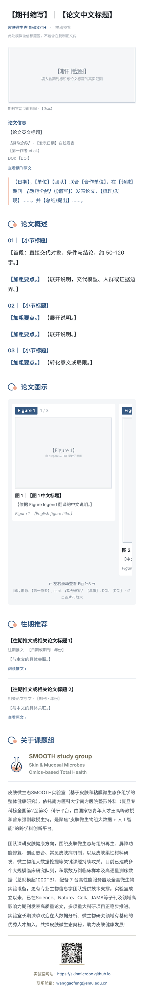

# cxj-smoothwrite

**smoothwrite v3.0.0**：把用户提供的论文 PDF 和期刊截图，按已确认的皮肤微生态 SMOOTH 模板、写法和文风，做成可编辑、可离线分享的公众号 HTML。打开后点 **“复制到公众号”**，就能直接粘贴进微信公众号官方编辑器，排版和图片都能保留。

## v3 有什么变化

- **改为“论文图示”：** 原来的“论文原文”逐页 PDF 页图，换成从 PDF 中提取的 **Fig 1、Fig 2……横向滑动卡片**。每张卡片有图、中文图题、中文说明和英文原题，图片不带水印和行号。
- **删除作者简介模块。**
- **保留往期推荐模块**，改为微信能保留的写法。
- **修复粘贴后乱码、图片丢失：**
  - 去掉了表格布局、绝对定位、svg 和按钮；
  - 标题图标改用 CSS 画，不再用小图；
  - logo 和二维码改为较大尺寸嵌入；
  - 图片统一压缩，整篇正文从约 7 MB 降到约 0.8 MB。
- **新增 `crop` 命令：** 图是矢量绘制、PDF 里没有内嵌位图时，按页面区域裁出来。

## 留空模板

**[下载可编辑的留空 HTML 模板](https://github.com/SkinMicrobe/cxj-smoothwrite/raw/refs/heads/main/examples/blank-template/preview.html)** · [占位 content.json](examples/blank-template/content.json)

用电脑浏览器打开，点“编辑文字与二维码”改内容，改完下载草稿保存。【括号内容】和占位图都要替换。正式制稿时，提供 PDF 和期刊截图，由 skill 完成替换和写作。



## 使用流程

提供：

1. 本期论文 PDF。
2. 两条指定往期推荐，每条附对应图片。
3. 本期论文的期刊官网截图，包含期刊标识和论文标题。

在 Codex 中调用：

> 使用 $smoothwrite，按 SMOOTH 模板为这篇论文制作公众号稿，往期推荐按我给的顺序和图片排版。

Codex 会阅读原文，撰写标题、团队导语和概述，提取并翻译 Fig 图题，核对两条推荐的论文信息和原文链接，各用一张指定图片，然后渲染 `preview.html`。

拿到 `preview.html` 后：

1. 用 Chrome 或 Edge 打开。
2. 在「设置论文与往期链接」中分别填入两篇公众号推文的地址，再点「复制到公众号」。
3. 在公众号后台正文区粘贴。
4. 等图片全部上传完再保存。
5. 发手机预览，检查 Fig 横滑。

## 已确认的完整范文

- **[下载 BJD 最终版 HTML](https://github.com/SkinMicrobe/cxj-smoothwrite/raw/refs/heads/main/examples/bjd-ljag463/preview.html)**：论文图示 Fig 1–3 横滑，加往期推荐。下载后用电脑浏览器打开，GitHub 文件页不渲染 HTML。
- [文字范文](examples/bjd-ljag463/article.md) · [content.json](examples/bjd-ljag463/content.json) · [配套图片](examples/bjd-ljag463/assets)

固定模块顺序：期刊截图 → 论文信息 → 团队导语 → 论文概述 → 论文图示 → 往期推荐 → 关于课题组。

- **配色与版式：** 沿用已确认的蓝橙配色和版式，每篇按原文替换内容。
- **标题：** 突出论文的核心对象和具体问题。
- **概述：** 约 800–1100 个可见字符，3 个左右小节，少用设问铺垫。
- **期刊名：** 英文期刊名用斜体，不加中文书名号。
- **证据归属：** 保留真实文章类型和证据归属，不把综述里引用的研究写成团队新实验。
- **不设的模块：** 不设作者简介、点评或招聘模块。
- **课题组介绍：** 保留用户确认的原文。其他团队需提供自己的 profile。

## 安装为 Codex skill

```bash
git clone https://github.com/SkinMicrobe/cxj-smoothwrite.git ~/.codex/skills/cxj-smoothwrite
```

如果本机已有这个目录，先备份本地修改再 `git pull`。入口文件是 [`SKILL.md`](SKILL.md)。

## 脚本

需要 Python 3.9 或更高版本，以及 PyMuPDF、Beautiful Soup、Pillow：

```bash
python3 -m venv .venv && source .venv/bin/activate
python -m pip install -r requirements.txt
```

下面是 Codex 内部使用的步骤。正文由 Codex 阅读论文后撰写，脚本只负责提取、渲染和检查：

```bash
python scripts/smoothwrite.py prepare --pdf paper.pdf --workdir work/paper
#  → paper_text.md、page-previews/、figure-candidates/（PDF 内嵌原图）
python scripts/smoothwrite.py crop --prepared work/paper --page 12 --bbox 0.08,0.1,0.92,0.62 --output work/fig2.png
python scripts/smoothwrite.py render --prepared work/paper --content work/content.json --output outputs/paper
python scripts/smoothwrite.py validate --output outputs/paper
```

字段说明见 [`references/content-schema.md`](references/content-schema.md)，交付与微信使用见 [`references/delivery.md`](references/delivery.md)，文风见 [`references/writing.md`](references/writing.md)。

`validate` 会检查微信兼容写法、图片尺寸、模块顺序和文字一致性。它不能代替科学事实核对，也不能代替公众号手机预览。生成 HTML 不会自动登录、导入或群发公众号。
